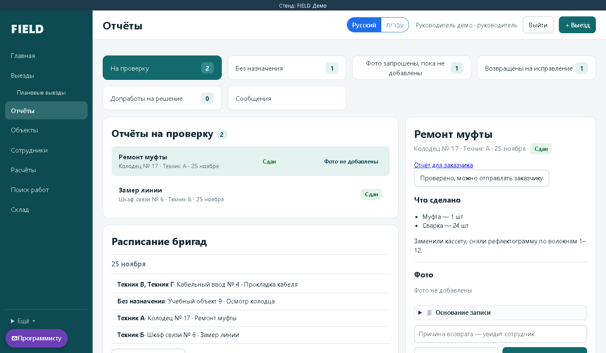
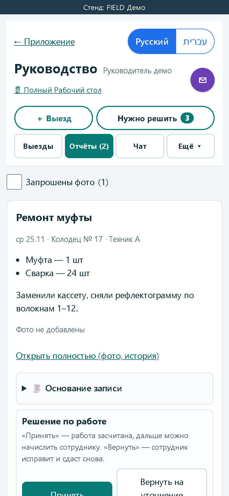
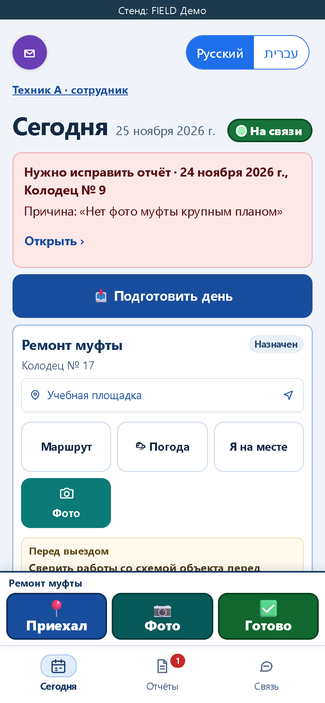

# FIELD

[Русское описание](README.md)

FIELD is a web application for managing field service work. It connects assignments, sites, staff, reports and payments. Technicians receive visits on their phones, record the work they complete and submit reports. Supervisors track progress, review reports and reconcile the figures for each period. For teams that build or maintain fiber-optic networks, FIELD includes the STV measurement module.

The [FIELD product presentation, 22 slides (PDF)](FIELD-presentation-en.pdf) covers the desktop and mobile menus, field workflows, STV, appearance settings and rollout options.

[Email us to request a demo or the standard version](mailto:panterka.smart@gmail.com?subject=FIELD)

## FIELD in use

These screenshots come from a FIELD training environment with sample data. The mobile screens were captured in a browser at phone size. The interface shown is in Russian.

### Supervisor on Windows

The reports list shows statuses. Selecting a report opens the work details on the right.

| Supervisor on a phone | Field employee on a phone |
| --- | --- |
| Reviews team reports and approves them or sends them back for clarification. | Sees assigned visits, opens visit details, checks in, adds photos and prepares reports. |
|  |  |

## Who it’s for

- **Field crews** receive assignments, look up site details, attach photos and documents, and submit reports from a phone.
- **Dispatchers and supervisors** schedule and assign visits, track progress, review reports and handle site issues.
- **Accounts teams** reconcile earnings, payouts, expenses, invoices and payments within their assigned permissions.
- **Fiber-optic specialists** link OTDR traces and measurements to sites, maintain registers and prepare technical datasheets.

## Features

### Visits and reports

- Schedule visits, assign technicians and track status.
- Maintain customer, staff and site records. View work and visit history, addresses, site points and plans.
- Mark arrival and link the location where the workflow calls for it.
- Report completed work with line items, quantities, comments, photos and attachments.
- Review reports, handle corrections and prepare customer-facing reports.
- Request additional work, track materials and stock, and keep plan versions and related notes.

### Mobile work and communication

- Use mobile views for technicians and supervisors, with a desktop workspace in the browser.
- Save drafts and queue submissions for supported mobile workflows, including reports and photos. Resume submission once the connection returns.
- Use internal chat, work contacts, help requests and push notifications where configured.

### Payments and period reconciliation

- Track accrued earnings by job, staff payouts and receipts. Staff can view their own earnings.
- Manage customer invoices, import an invoice register from CSV, record payments and reconcile invoices.
- Reconcile a period with access to the underlying records. Close the period, save snapshots, print forms and export data to CSV.

### Fiber-optic measurements with STV

- Open OTDR files in SOR format. View the trace, event table, distances, losses and reflections.
- Check recorded events against configurable thresholds, compare traces and account for a launch cable in supported files.
- Link measurements to visits and sites, keep original files, and maintain registers for cables, fibers and instruments.
- Prepare acceptance packs and technical datasheets in PDF.

### Access and administration

- Manage staff and supervisor accounts, with access based on roles and assigned companies.
- Use the activity log, archives, and tools for backup and recovery.
- Deploy FIELD on a server. The web application uses PHP, MariaDB and JavaScript.

## Menu guide

Menu names below are English translations for reference.

| Where to look | What opens |
| --- | --- |
| **Desktop / Home** | Counters and work needing a decision. The “+ Visit” button opens the new assignment form. |
| **Desktop / Visits, Scheduled Visits, Reports** | Work lists and individual records. The desktop workspace shows selected details on the right. |
| **Desktop / Sites, Staff, Search Work** | Site and staff records, visit history and plans, and search for work records. |
| **Desktop / Payments, Inventory** | Earnings, payouts and outstanding balances. Equipment and stock records. |
| **Desktop / More** | Full visit and report lists, recurring faults, vehicle inspections, work types, incoming invoices, work receipts, backups and instance appearance. |
| **Technician’s phone / Today, Reports, Communication** | Assignments by date, personal reports and work communication. A visit opens the route, materials, plan and measurements. |
| **Supervisor’s phone / Supervisor** | “+ Visit” and “Needs Attention” in the header, with Visits, Reports and Chat tabs. More opens Payments, Reconciliation, Staff, Inventory and Appearance, subject to permissions. |
| **STV / Events, Span, Thresholds, File** | The trace and events, span parameters, threshold settings and file details. Measurements can be linked to a visit. |

## Themes and company branding

Each FIELD installation can reflect the team’s visual identity. A supervisor can choose the standard or Sunny color scheme, upload backgrounds for the sign-in screen and workspace, and add a branded icon, header image and corner illustration. Desktop and mobile can have different backgrounds. Changes apply to the selected installation.

On desktop, open **Workspace / More / Instance Appearance**. On a supervisor’s phone, open **Supervisor / More / Appearance**.

## Languages

The current interface is available in **Russian and Hebrew**, with right-to-left layout for Hebrew. Custom localization is available for any requested language. The work can include interface text, notifications, report forms, printed documents, local date and number formats, and testing of right-to-left layouts where needed.

## Paid customization for your company

Additional modules and workflow changes are available as paid services. Options include custom roles and approvals, industry-specific forms and reports, integrations with accounting systems, data migration and simpler workflows for field staff. Scope, timing and pricing are agreed after discussing your requirements and existing systems.

## Demo and access

**The current standard version of FIELD is available free of charge for use without redistribution rights.** Contact the rights holder to obtain the standard version and its terms of use. Source code access, deployment and support are agreed separately.

For demo, standard version or customization inquiries, email [panterka.smart@gmail.com](mailto:panterka.smart@gmail.com?subject=FIELD).

A demo can cover a visit from assignment through report review, show what happens when connectivity drops, trace the figures behind staff earnings and produce a technical datasheet using sample measurements. For a pilot, the teams agree on roles, scenarios and acceptance criteria in advance.
