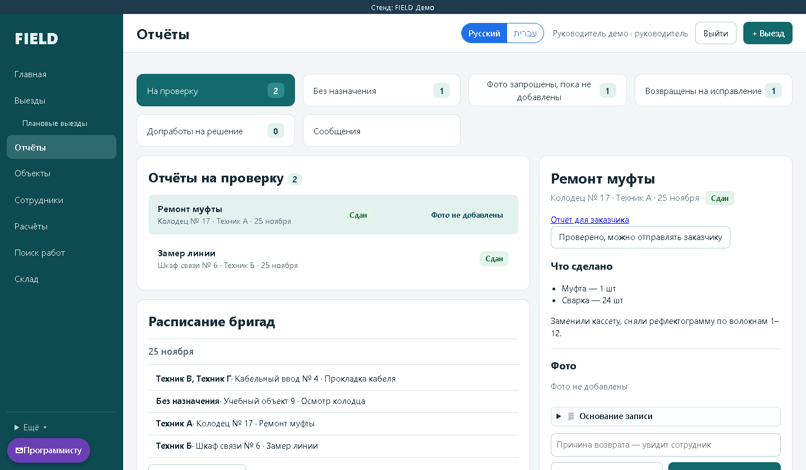
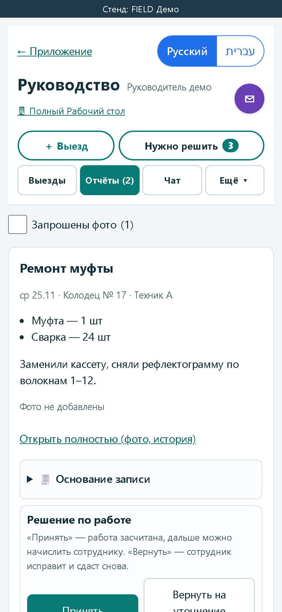
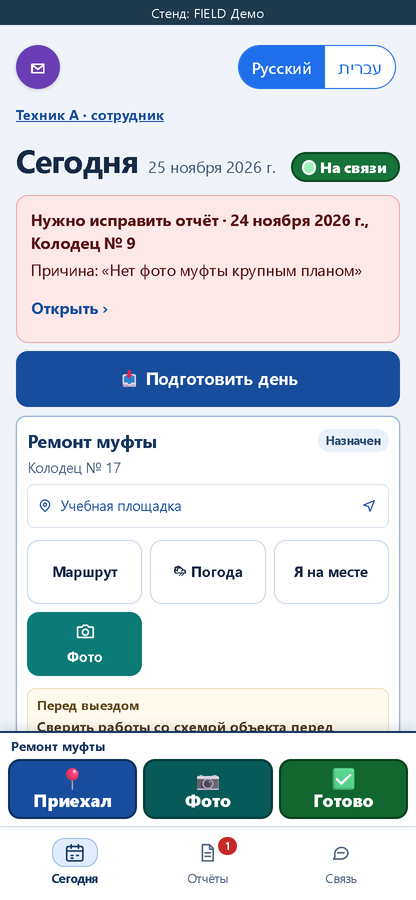

# FIELD

[English overview and presentation](README.en.md)

FIELD — веб-программа для управления выездными работами. Она связывает задания, объекты, сотрудников, отчёты и расчёты. Исполнитель получает выезд на телефоне, фиксирует выполненную работу и отправляет отчёт. Руководитель видит ход работ, проверяет отчёты и сверяет итоги за период. Для строительства и обслуживания волоконно-оптических сетей в FIELD есть модуль измерений STV.

[Продуктовая презентация FIELD, 22 слайда (PDF)](FIELD-presentation.pdf) охватывает меню компьютера и телефона, рабочие сценарии, STV, оформление интерфейса и варианты внедрения.

## Как выглядит FIELD

Скриншоты сделаны в учебной версии FIELD с демонстрационными данными. Мобильные экраны сняты в браузере в размере экрана телефона.

### Руководитель на Windows

В списке отчётов видны статусы, а справа открывается выбранная карточка с результатами работ.

| Руководитель на телефоне | Сотрудник на телефоне |
| --- | --- |
| Проверяет отчёты команды, принимает работу или возвращает отчёт на уточнение. | Видит свои задания, открывает карточку выезда, отмечает прибытие, добавляет фото и готовит отчёт. |
|  |  |

## Кому подходит

- **Выездным бригадам** — получать задания, находить сведения об объекте, прикладывать фотографии и документы, отчитываться с телефона.
- **Диспетчерам и руководителям** — планировать и распределять выезды, отслеживать статусы, проверять отчёты и решать вопросы по объектам.
- **Сотрудникам, которые ведут расчёты** — сверять начисления, выплаты, расходы, счета и оплаты в пределах предоставленных прав.
- **Специалистам по ВОЛС** — привязывать рефлектограммы и результаты измерений к объектам, вести реестр и готовить технические паспорта.

## Возможности

### Выезды и отчёты

- Планирование выездов, назначение исполнителей и отслеживание статусов.
- Карточки заказчиков, сотрудников и объектов. История работ и выездов по объекту, адреса, точки и схемы.
- Отметка о прибытии и привязка к месту, когда это предусмотрено рабочим процессом.
- Отчёты о выполненных работах с позициями, объёмами, комментариями, фотографиями и вложениями.
- Проверка отчётов руководителем, работа с замечаниями и подготовка отчёта для заказчика.
- Заявки на дополнительные работы, учёт материалов и складских остатков, история версий схем и замечаний.

### Работа с телефона и связь

- Мобильные интерфейсы сотрудника и руководителя, рабочий стол в браузере на компьютере.
- Сохранение черновиков и очередь отправки для поддерживаемых мобильных сценариев, включая отчёты и фотографии. Когда связь возвращается, пользователь может продолжить отправку.
- Внутренний чат, контакты, обращения за помощью и push-уведомления при соответствующей настройке.

### Расчёты и контроль периода

- Начисления по работам, персональный просмотр своих начислений, учёт выплат сотрудникам и проверка чеков.
- Счета заказчиков, импорт реестра счетов из CSV, учёт оплат и сверка счетов.
- Сверка за период с детализацией. Закрытие периода, сохранение снимков, печатные формы и выгрузка данных в CSV.

### Измерения ВОЛС — STV

- Открытие и просмотр файлов OTDR в формате SOR. График трассы, таблица событий, расстояния, потери и отражения.
- Анализ записанных прибором событий по настраиваемым порогам, сравнение трасс и учёт компенсационной катушки для поддерживаемых файлов.
- Привязка измерений к выездам и объектам, хранение оригиналов, реестр кабелей, волокон и измерительных приборов.
- Подготовка приёмочных пакетов и технических паспортов в PDF.

### Доступ и сопровождение

- Учётные записи сотрудников и руководителей, разграничение доступа по ролям и назначенным компаниям.
- Журнал действий, архивы и инструменты резервного копирования и восстановления.
- Развёртывание на сервере. Веб-часть использует PHP, MariaDB и JavaScript.

## Карта меню

| Где | Что открывается |
| --- | --- |
| **Компьютер / Главная** | Счётчики и задачи, которые требуют решения. Кнопка «＋ Выезд» открывает создание задания. |
| **Компьютер / Выезды, Плановые выезды, Отчёты** | Рабочие списки и карточки. В рабочем столе подробности выбранной записи открываются справа. |
| **Компьютер / Объекты, Сотрудники, Поиск работ** | Карточки объектов и сотрудников, история выездов и схемы, поиск записей о работах. |
| **Компьютер / Расчёты, Склад** | Начисления, выплаты и остаток к выплате. Учёт оборудования и складских позиций. |
| **Компьютер / Ещё** | Полные списки выездов и отчётов, повторные неисправности, осмотры машин, виды работ, входящие счета, рабочие чеки, резервные копии и оформление стенда. |
| **Телефон сотрудника / Сегодня, Отчёты, Связь** | Задания по датам, свои отчёты и рабочая связь. Из карточки выезда открываются маршрут, материалы, схема и измерения. |
| **Телефон руководителя / Руководство** | «＋ Выезд» и «Нужно решить» в шапке, вкладки «Выезды», «Отчёты» и «Чат». Разделы «Деньги», «Сверка», «Сотрудники», «Склад» и «Оформление» доступны через «Ещё» по правам. |
| **STV / События, Span, Пороги, Файл** | Трасса и события, параметры участка, настройки порогов и сведения о файле. Измерение можно привязать к выезду. |

## Своя тема и фирменный стиль

Каждую установку FIELD можно оформить в стиле своей команды. Руководитель выбирает стандартную или солнечную цветовую схему, загружает свои фоны для экрана входа и рабочих экранов, добавляет фирменный значок, изображение в шапку и иллюстрацию в угол. Для телефона и компьютера можно задать разные фоны. Изменения действуют на выбранной установке.

Настройки открываются из меню **«Рабочий стол» / «Ещё» / «Оформление стенда»**. На телефоне руководителя они находятся в разделе **«Руководство» / «Ещё» / «Оформление»**.

## Языки

В текущей версии интерфейс доступен на **русском и иврите**. Для иврита предусмотрено отображение справа налево. По заказу FIELD можно локализовать на любой требуемый язык. В локализацию могут входить интерфейс, уведомления, отчётные формы, печатные документы, форматы дат и чисел и проверка отображения справа налево.

## Платная адаптация под компанию

За отдельную плату можно добавить модули и доработать FIELD под конкретный процесс. Например, настроить роли и согласования, разработать отраслевые формы и отчёты, подключить обмен с учётной системой, перенести справочники и данные или упростить типовые операции для выездных сотрудников. Состав работ, сроки и стоимость согласовываются после обсуждения задач и текущей инфраструктуры.

## Доступ к программе

**Базовая версия FIELD в текущей комплектации предоставляется бесплатно для использования без права распространения.** Для получения базовой версии и условий использования обратитесь к правообладателю. Условия доступа к исходному коду, установки и сопровождения согласовываются отдельно.

На демонстрации можно пройти рабочий сценарий от назначения выезда до проверки отчёта, посмотреть, что происходит при потере связи, открыть детализацию начислений и собрать технический паспорт по учебным измерениям. Для пилота заранее согласовываются роли, сценарии и критерии приёмки.
